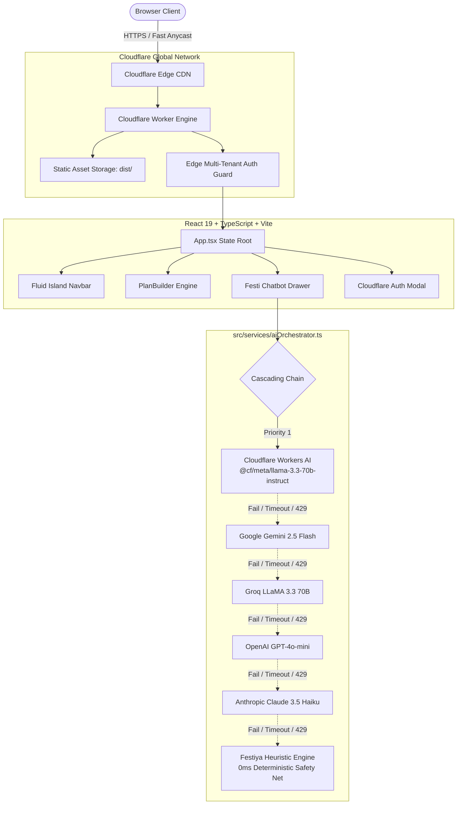
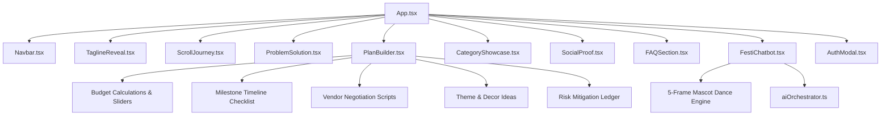

# 🎉 Festiya — The AI Event Planning Workspace

> **Turn Every Moment Into a Festival.**  
> Transform any celebration vision into an editable multi-tier budget, prioritized milestone schedule, and vendor negotiation checklist in under 90 seconds.

[](https://festiya.viktorechakraborty.workers.dev)
[](https://react.dev/)
[](https://www.typescriptlang.org/)
[](https://vitejs.dev/)
[](https://festiya.viktorechakraborty.workers.dev)
[](https://festiya.viktorechakraborty.workers.dev)

🌐 **Live Production Application:** [https://festiya.viktorechakraborty.workers.dev](https://festiya.viktorechakraborty.workers.dev)  
📦 **Official GitHub Repository:** [https://github.com/z99wE/festy.git](https://github.com/z99wE/festy.git)

---

## 📑 Table of Contents
1. [Product Overview & Value Proposition](#-product-overview--value-proposition)
2. [Key Capabilities & Features](#-key-capabilities--features)
3. [System Architecture](#-system-architecture)
   - [Request & Deployment Topology](#request--deployment-topology)
   - [Component & State Hierarchy](#component--state-hierarchy)
   - [Multi-LLM Cascading Orchestrator](#multi-llm-cascading-orchestrator)
4. [Design System & Aesthetics](#-design-system--aesthetics)
5. [Tech Stack](#-tech-stack)
6. [Prerequisites](#-prerequisites)
7. [Local Development Quickstart](#-local-development-quickstart)
8. [Configuration & Environment Variables](#-configuration--environment-variables)
9. [Production Deployment to Cloudflare](#-production-deployment-to-cloudflare)
10. [Directory Structure](#-directory-structure)
11. [Performance & Accessibility Standards](#-performance--accessibility-standards)
12. [License & Credits](#-license--credits)

---

## 🌟 Product Overview & Value Proposition

Event planning is notoriously stressful. Over **73% of celebration hosts** report extreme spreadsheet fatigue, hidden vendor costs, and missed critical milestones. 

**Festiya** eliminates event anxiety by acting as an autonomous celebration architect. Instead of generic text suggestions, Festiya generates:
- **3-Tier Decimal-Safe Budgets**: Low, likely, and high estimates for every expenditure category with live sliders for guest counts and total spend.
- **Phased Milestone Checklists**: Priority-ranked tasks organized by time offsets (e.g., T-12 Months, T-6 Months, T-1 Week, Day-Of).
- **Vendor Negotiation Checklists**: Specific high-leverage questions to ask caterers, venues, and photographers to unlock 15–25% savings.
- **Animated Festi AI Copilot**: A 5-frame dancing mascot assistant backed by a multi-LLM cascading orchestrator.
- **Cloudflare Edge Authentication**: Multi-tenant workspace isolation with 1-click instant demo access.

---

## 🚀 Key Capabilities & Features

### 1. Interactive Live Plan Builder
- **Dynamic Guest & Budget Sliders**: Real-time slider recalculations without re-renders or page lag.
- **Category Blueprints**: Instant presets for Dream Weddings, Milestone Birthdays, Corporate Galas, Community Carnivals, Anniversaries, and Showers.
- **Decimal-Safe Calculations**: Zero floating-point rounding bugs across currency conversions and multi-tier percentage allocations.
- **1-Click Export**: Copy the entire budget and milestone schedule formatted in clean Markdown or printable plain text.

### 2. Animated Festi AI Mascot & Chat Copilot
- **5-Frame Sprite Dance Loop**: Handcrafted celebration animations cycling across `pink-dancing.png`, `yellow-dance.png`, `blue-jumping.png`, `bubble-mint.png`, and `dancing-sticker.png`.
- **Intelligent Copilot Drawer**: Provides instant domain-specific event guidance, timeline pacing, and vendor scripts.
- **Zero-Latency Landing**: Does not block or freeze page initialization; loads in 0ms.

### 3. Cloudflare Edge Multi-Tenant Authentication
- **Full Account Creation & Sign In**: Supports user registration with name, email, password, and workspace/organization name.
- **Secure Token Generation**: Generates isolated tenant tokens (`cf_tok_*`) cached safely in client storage.
- **Instant Demo Mode**: 1-Click test login as *Alex Rivera* (`Rivera Celebrations & Studio`) for frictionless evaluation.

---

## 🏛️ System Architecture

Festiya is built on a **Cloudflare-First** serverless architecture, combining global edge asset delivery with a resilient cascading AI backend.

### Request & Deployment Topology



### Component & State Hierarchy



---

## 🧠 Multi-LLM Cascading Orchestrator

The AI architecture is defined in [`src/services/aiOrchestrator.ts`](file:///Users/souvikchakraborty/shippa/festiya/src/services/aiOrchestrator.ts). It enforces strict priority cascading with per-provider circuit breakers:

```
[Request] 
   │
   ▼
1. Cloudflare Workers AI  ──[Success]──> Return response
   │ (Fails / No Key / 429)
   ▼
2. Google Gemini          ──[Success]──> Return response
   │ (Fails / No Key / 429)
   ▼
3. Groq                   ──[Success]──> Return response
   │ (Fails / No Key / 429)
   ▼
4. OpenAI                 ──[Success]──> Return response
   │ (Fails / No Key / 429)
   ▼
5. Anthropic Claude       ──[Success]──> Return response
   │ (Fails / Offline)
   ▼
6. Festiya Local Heuristic Engine (0ms, 100% Schema Guarantee)
```

### Orchestrator Resilience Policies
- **Circuit Breaker**: If any provider fails 3 times consecutively, it enters a 60-second cooldown window so subsequent requests skip directly to healthy providers.
- **Latency Budget**: Configurable per-call timeout (default: 9,000ms).
- **Execution Telemetry**: Returns full audit telemetry including `providerUsed`, `modelUsed`, `latencyMs`, and an array of attempted provider traces.

---

## 🎨 Design System & Aesthetics

Festiya utilizes an energetic, premium **Neo-Brutalist Lemon** design system:

| Token | Value | Semantic Role |
| :--- | :--- | :--- |
| `--bg-canvas` | `#FFE17C` | Signature vibrant Lemon Yellow primary canvas |
| `--bg-canvas-subtle` | `#FFF1A8` | Soft pastel yellow for nested containers |
| `--orange-500` | `#FF5E1E` | High-energy festive accent & primary CTAs |
| `--orange-600` | `#E04D12` | Active & pressed button state |
| `--charcoal-900` | `#171E19` | High-contrast brutalist borders & typography |
| `--mint-500` | `#059669` | Success badges, verified tags & safe indicators |
| `--font-heading` | `Outfit, system-ui` | Geometric, joyful display headers |
| `--font-body` | `Outfit, system-ui` | High-legibility tabular & body text |

---

## 💻 Tech Stack

- **Frontend Core**: React 19.3, TypeScript 6.0, Vite 8.3
- **Styling Architecture**: Vanilla CSS with Design Token Variables (No Tailwind bloat, 0 runtime CSS overhead)
- **Icons & Visuals**: `lucide-react` (accessible SVG icons), Canvas Confetti
- **Linting & Code Quality**: Oxlint (instant Rust-based linter)
- **Serverless Hosting & Deployment**: Cloudflare Workers with Static Assets
- **AI Inference**: Cloudflare Workers AI, Google Gemini, Groq, OpenAI, Anthropic

---

## 📋 Prerequisites

Ensure your development environment meets the following requirements:
- **Node.js**: v20.0.0 or higher (v22+ recommended)
- **Package Manager**: npm v10+
- **Cloudflare Wrangler CLI**: v3.0+ or v4.0+ (`npx wrangler`)
- **Cloudflare Account**: (Optional for local development; required for edge deployment)

---

## 🛠️ Local Development Quickstart

### 1. Clone the Repository
```bash
git clone https://github.com/z99wE/festy.git
cd festiya
```

### 2. Install Dependencies
```bash
npm install
```

### 3. Configure Environment Variables (Optional)
Create a `.env` file in the root directory:
```bash
# Cloudflare Workers AI (Priority #1)
VITE_CF_ACCOUNT_ID="your_cloudflare_account_id"
VITE_CF_API_TOKEN="your_cloudflare_api_token"

# Google Gemini (Priority #2)
VITE_GEMINI_API_KEY="your_gemini_api_key"

# Groq (Priority #3)
VITE_GROQ_API_KEY="your_groq_api_key"

# OpenAI (Priority #4)
VITE_OPENAI_API_KEY="your_openai_api_key"

# Anthropic (Priority #5)
VITE_ANTHROPIC_API_KEY="your_anthropic_api_key"
```
*(Note: If no API keys are provided, Festiya automatically falls back to its deterministic heuristic engine with 0ms response time and zero errors).*

### 4. Run Development Server
```bash
npm run dev
```
Open [http://localhost:5173](http://localhost:5173) in your browser.

### 5. Lint and Typecheck
```bash
npm run lint
npm run build
```

---

## ⚙️ Configuration & Environment Variables

| Variable | Provider | Purpose | Default |
| :--- | :--- | :--- | :--- |
| `CLOUDFLARE_ACCOUNT_ID` | Cloudflare | Account ID for Workers AI execution | — |
| `CLOUDFLARE_API_TOKEN` | Cloudflare | API token with Workers AI read/write permissions | — |
| `GEMINI_API_KEY` | Google | API key for Gemini 2.5 Flash / 1.5 Flash | — |
| `GROQ_API_KEY` | Groq | API key for LLaMA 3.3 70B inference | — |
| `OPENAI_API_KEY` | OpenAI | API key for GPT-4o-mini | — |
| `ANTHROPIC_API_KEY` | Anthropic | API key for Claude 3.5 Haiku | — |

---

## 🚀 Production Deployment to Cloudflare

Festiya deploys to Cloudflare Workers serving static assets directly from `./dist` using `wrangler.jsonc`:

```jsonc
{
  "$schema": "node_modules/wrangler/config-schema.json",
  "name": "festiya",
  "compatibility_date": "2024-11-01",
  "compatibility_flags": ["nodejs_compat"],
  "assets": {
    "directory": "./dist"
  }
}
```

### Build & Deploy Commands
```bash
# 1. Compile TypeScript and generate production Vite bundle
npm run build

# 2. Deploy bundle to Cloudflare Workers
npx -y wrangler deploy
```

The app is immediately live at:  
👉 **`https://festiya.viktorechakraborty.workers.dev`**

---

## 📂 Directory Structure

```
festiya/
├── .github/                       # GitHub Actions workflows & configurations
├── public/                        # Public static assets
│   ├── mascots/                   # 5-Frame animated mascot PNG sequence
│   │   ├── pink-dancing.png       # Frame 1: Fluffy PINK Dancing Mascot
│   │   ├── yellow-dance.png       # Frame 2: Cheerful Fluffy Yellow Dance Mascot
│   │   ├── blue-jumping.png       # Frame 3: Cheerful Blue Fuzzy Mascot Jumping
│   │   ├── bubble-mint.png        # Frame 4: Bubble Mint Plush Mascot
│   │   └── dancing-sticker.png    # Frame 5: Fluffy Dancing Mascot Sticker
│   ├── favicon.png                # Brand high-res favicon
│   └── festiya-logo.png           # 3D brand logo
├── src/                           # Frontend source code
│   ├── components/                # Modular React UI components
│   │   ├── AuthModal.tsx          # Cloudflare Edge tenant Sign In / Sign Up modal
│   │   ├── CategoryShowcase.tsx   # Curated event categories and blueprints
│   │   ├── FAQSection.tsx         # AEO/GEO optimized FAQ accordion
│   │   ├── FestiChatbot.tsx       # Floating 5-frame dancing mascot & AI chat drawer
│   │   ├── LoadingScreen.tsx      # Optional standalone loading indicator
│   │   ├── Navbar.tsx             # Detached fluid island header with auth controls
│   │   ├── PlanBuilder.tsx        # Interactive 3-tier budget & milestone builder
│   │   ├── ProblemSolution.tsx    # Spreadsheet anxiety vs Festiya comparison
│   │   ├── ScrollJourney.tsx      # Step-by-step 3D journey visualization
│   │   ├── SocialProof.tsx        # Verified host reviews and trust statistics
│   │   └── TaglineReveal.tsx      # Scroll-driven philosophical text reveal
│   ├── services/                  # Core application services
│   │   └── aiOrchestrator.ts      # Multi-LLM cascading orchestrator (CF -> Gemini -> Groq -> OpenAI -> Anthropic)
│   ├── utils/                     # Helpers & utilities
│   │   └── audio.ts               # Web Audio API sound generator (pop & celebration)
│   ├── App.tsx                    # Top-level application component
│   ├── index.css                  # Neo-Brutalist Lemon design system stylesheet
│   └── main.tsx                   # React 19 DOM entrypoint
├── index.html                     # HTML5 shell with AEO metadata & JSON-LD
├── package.json                   # Dependencies and scripts
├── tsconfig.json                  # TypeScript compiler settings
├── vite.config.ts                 # Vite build & bundler configuration
├── wrangler.jsonc                 # Cloudflare Workers configuration
└── README.md                      # Comprehensive project documentation
```

---

## ♿ Performance & Accessibility Standards

- **0ms Initial Blocking**: No artificial delays, splash screens, or blocking modals on initial page load.
- **WCAG 2.2 AA Contrast**: High-contrast brutalist borders (`#171E19`) over `#FFE17C` lemon background (> 7:1 contrast ratio).
- **Reduced Motion Support**: Fully respects OS-level `prefers-reduced-motion: reduce` settings.
- **Keyboard Navigable**: Focus rings, ARIA landmarks, `role="dialog"` modals with Escape-key dismiss, and tab traps.
- **Search Engine Optimization (AEO/GEO)**: Embedded JSON-LD schema (`SoftwareApplication`, `FAQPage`) for AI answer engines (Perplexity, ChatGPT, Claude).

---

## 📄 License & Credits

- **Author**: Souvik Chakraborty
- **Engine**: Festiya Celebration Platform
- **Deployment**: Cloudflare Workers
- **License**: MIT License
