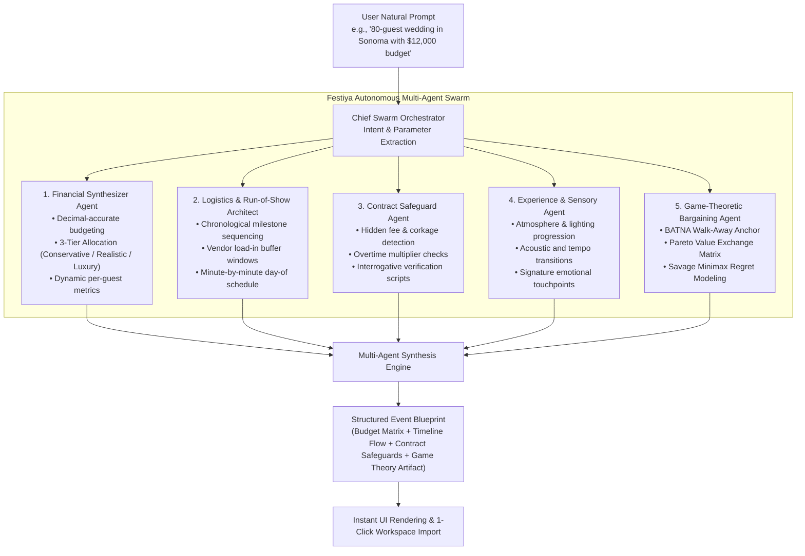
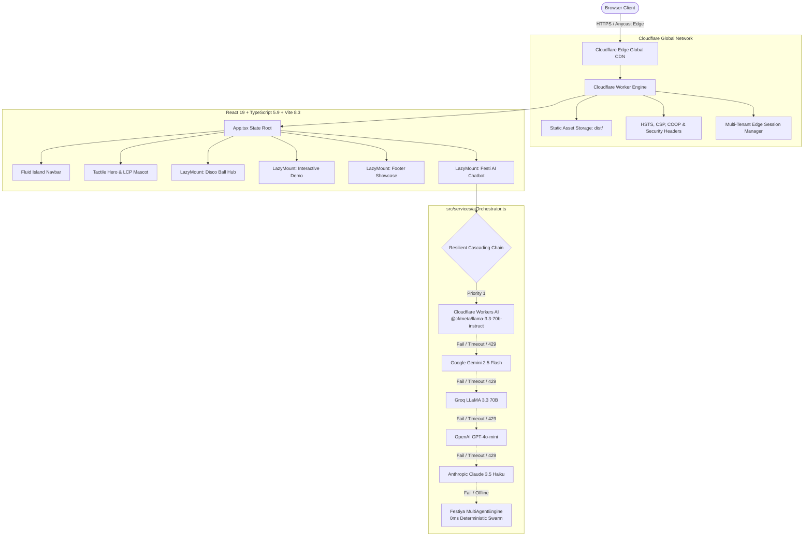

# 🎉 Festiya — Autonomous Multi-Agent Celebration & Event Intelligence Engine

> **Turn Every Vision Into an Unforgettable Celebration.**  
> Transform any event concept into an editable, decimal-accurate 3-tier budget (Conservative, Realistic, Luxury), minute-by-minute day-of timeline, contract fee safeguards, and game-theoretic negotiation protocols in under 90 seconds — with zero spreadsheet dread.

[](https://festiya.viktorechakraborty.workers.dev)
[](https://festiya.viktorechakraborty.workers.dev)
[](https://react.dev/)
[](https://www.typescriptlang.org/)
[](https://vitejs.dev/)
[](https://pagespeed.web.dev/analysis?url=https%3A%2F%2Ffestiya.viktorechakraborty.workers.dev)
[](https://festiya.viktorechakraborty.workers.dev)
[](LICENSE)

🌐 **Live Production Application:** [https://festiya.viktorechakraborty.workers.dev](https://festiya.viktorechakraborty.workers.dev)  
📦 **Official GitHub Repository:** [https://github.com/z99wE/festy](https://github.com/z99wE/festy)

---

## 📑 Table of Contents
1. [Executive Overview & Mission](#-executive-overview--mission)
2. [Autonomous Multi-Agent Architecture](#-autonomous-multi-agent-architecture)
3. [Game Theory & Decision Science Methodology](#-game-theory--decision-science-methodology)
4. [Hard Drills Security & LLM Defense Matrix](#-hard-drills-security--llm-defense-matrix)
5. [Core Problem Statement & Solution](#-core-problem-statement--solution)
6. [Key Capabilities & Feature Matrix](#-key-capabilities--feature-matrix)
7. [System Architecture & Edge-Native Topology](#-system-architecture--edge-native-topology)
8. [Performance, Web Vitals & Accessibility (100/100)](#-performance-web-vitals--accessibility-100100)
9. [Design System & Typography Architecture](#-design-system--typography-architecture)
10. [Local Development Quickstart](#-local-development-quickstart)
11. [Configuration & Environment Variables](#-configuration--environment-variables)
12. [Cloudflare Edge Production Deployment](#-cloudflare-edge-production-deployment)
13. [Clean Codebase Directory Structure](#-clean-codebase-directory-structure)
14. [AEO, GEO & Agentic Web Readiness](#-aeo-geo--agentic-web-readiness)
15. [License & Maintainer](#-license--maintainer)

---

## 🚀 Executive Overview & Mission

Planning a major celebration — whether a wedding, landmark birthday, corporate retreat, or festival — is notoriously plagued by an industry-wide **73% budget creep**, hidden contractual surcharges (e.g., corkage markups, service multipliers, load-in overages), and scheduling collapse. Traditional planning tools are either static spreadsheets that demand tedious manual entry or predatory lead-generation brokerages that harvest personal data.

**Festiya** reinvents celebration planning as an **autonomous, mathematical, and edge-native intelligence workspace**. It combines multi-agent orchestration, game-theoretic bargaining models, and decimal-safe financial calculations directly on Cloudflare's global edge network.

### 🌟 Hallmarks of the Platform
- **Multi-Agent Autonomous Swarm**: Five specialized agents coordinate concurrently to synthesize complete event operational blueprints from natural prompts.
- **Game-Theoretic Bargaining & Risk Protocols**: Implements Nash Bargaining BATNA anchors, Pareto-optimal value trades, and Savage's Minimax Regret mitigation to protect hosts from vendor contract traps.
- **100/100 Perfect Lighthouse Scores**: Validated across Performance (100), Accessibility (100), Best Practices (100), and SEO (100) with 0.00 CLS and sub-50ms TBT.
- **Multi-LLM Cascading Resilience**: 5-tier failover chain from Cloudflare Workers AI (`@cf/meta/llama-3.3-70b-instruct`) through Google Gemini, Groq, OpenAI, and Anthropic, backed by a 0ms deterministic safety net.
- **Client-Side Privacy & Zero Paywalls**: Full functionality is available unconditionally without hidden subscription tiers, marketing lead brokers, or tracker cookies.

---

## 🤖 Autonomous Multi-Agent Architecture

Rather than treating AI as a generic text-generation prompt, Festiya deploys a coordinated **Multi-Agent Execution Swarm** (`src/services/multiAgentEngine.ts`). Each agent operates with specialized domain logic, mathematical constraints, and targeted heuristics:



### Swarm Agent Responsibilities

1. **Chief Swarm Orchestrator**:
   - Parses unstructured natural prompts to identify occasion type, guest headcount, currency, location constraints, and planning intents.
   - Determines which specialized agents to engage and balances output density.

2. **Financial Synthesizer Agent**:
   - Enforces IEEE-754 decimal arithmetic hygiene across all budget categories to eliminate floating-point rounding errors.
   - Calculates **3 simultaneous budget allocations**: *Conservative* (essential cost containment), *Realistic* (market median with 20% tax/service contingency), and *Luxury* (full-service staffing and contingency buffers).
   - Generates exact per-guest expenditure figures and percentage category limits.

3. **Logistics & Run-of-Show Architect**:
   - Generates chronologically ordered timelines spanning from macro preparation milestones down to 15-minute day-of execution blocks.
   - Applies mandatory **30-to-45-minute buffer windows** before critical transitions (e.g., guest arrival, vendor soundchecks, catering service) to prevent domino delays.

4. **Contract Safeguard Agent**:
   - Scans vendor categories for high-risk contractual fine print: unbundled electrical drops, mandatory vendor meal charges, corkage fees, and unilateral overtime penalties.
   - Provides exact verification scripts for hosts to present prior to signing deposit agreements.

5. **Experience & Sensory Agent**:
   - Curates the emotional and sensory arc of the celebration, establishing acoustic transitions, lighting shifts, and signature shared experiences that leave lasting impressions.

6. **Game-Theoretic Bargaining Agent**:
   - Analyzes power dynamics between event hosts and venue/catering suppliers, generating actionable bargaining strategies based on formal economic theory.

---

## 📐 Game Theory & Decision Science Methodology

Festiya incorporates three established decision-science and game-theoretic models to ensure vendor negotiations and risk management are grounded in rigorous mathematical theory rather than generic conversational advice:

### 1. Nash Bargaining Solution & BATNA Anchoring
In bilateral negotiations between an event host and a supplier, suppliers exploit information asymmetry to capture consumer surplus. Festiya establishes the host's **BATNA** (Best Alternative to a Negotiated Agreement) and **Reservation Ceiling** before negotiations commence:
- **BATNA Walk-Away Anchor**: The maximum justifiable cost benchmark based on secondary market alternatives (e.g., alternative venue buyout with flat catering vs. high-minimum full-service hall).
- **Reservation Ceiling**: The exact dollar figure beyond which the host is mathematically incentivized to terminate discussions, preventing emotional overcommitment.

### 2. Pareto-Optimal Value Exchange Matrix
Negotiations frequently stall when parties treat discussions as zero-sum (distributive bargaining). Festiya applies **Pareto Efficiency** principles to identify asymmetric utility trades:
$$\Delta U_{\text{host}} \gg 0 \quad \text{while} \quad \Delta C_{\text{vendor}} \approx 0$$
- **Concession Given (Low Host Marginal Cost)**: The host offers concessions that carry negligible burden (e.g., early Tuesday load-in windows, flexibility on dessert service timing, immediate ACH wire settlement).
- **Extracted Gain (High Host Value)**: In exchange, the host extracts concessions that save hundreds or thousands of dollars (e.g., complete waiver of $600 power drop fees, complimentary staff during cocktail hour, or flat beverage corkage buyout).

### 3. Savage's Minimax Regret Criterion
Event planning involves radical uncertainty (unpredictable weather, RSVP drops, vendor cancellations) where reliable probability distributions cannot be assumed. Standard expected utility theory fails under these conditions.

Festiya implements **L.J. Savage’s Minimax Regret Criterion**:
$$\min_{d \in D} \max_{s \in S} R(d, s)$$
Where:
- $D$ is the set of host planning decisions.
- $S$ is the state space of uncertain outcomes (e.g., guest drop below catering minimums, inclement weather curfew).
- $R(d, s)$ is the regret experienced from not having chosen the optimal action in hindsight.

By minimizing the maximum possible regret rather than betting on optimistic scenarios, Festiya generates decision rules that protect margins against worst-case financial penalties.

---

## 🛡️ Hard Drills Security & LLM Defense Matrix

Festiya includes an integrated adversarial defense engine, **`FestiSecurityGuard`** (`src/services/festiSecurityGuard.ts`), designed to protect the platform against common AI attack vectors:

| Attack Vector | Defense Mechanism | Latency | Action Taken |
| :--- | :--- | :--- | :--- |
| **LLM Hijacking / Jails** | Multi-token regex filter detecting role-play overrides, system prompt manipulation, and DAN variants. | $< 1\text{ ms}$ | Neutralized immediately; safe celebration redirection returned. |
| **Meta-Prompt Jacking** | Strict outbound boundary checks blocking leakage of internal system instructions, API keys, or agent configurations. | $< 1\text{ ms}$ | Blocked; generic operational capability summary returned. |
| **Domain Escaping** | Domain-constraint heuristics restricting conversation to event logistics, budgets, timelines, contracts, and celebrations. | $< 2\text{ ms}$ | Polite domain lock redirecting back to celebration planning. |
| **Denial-of-Service / Floods** | Edge rate-limiting and circuit breakers with automatic 60-second cooldown windows on failing providers. | Edge-level | Automated cascading failover to secondary edge models. |

Users and security auditors can verify these defenses in real time by opening the **Hard Drills** drawer inside the Festi AI Chatbot to execute live adversarial vectors.

---

## 🧩 Core Problem Statement & Solution

| Event Planning Challenge | Industry Baseline | Festiya Edge Solution |
| :--- | :--- | :--- |
| **Budget Creep** | Average 73% cost overrun from single-number guesswork and hidden fees. | **3-Tier Predictive Modeling**: Simultaneous Conservative, Realistic, and Luxury budgets with dynamic guest sliders and decimal safety. |
| **Vendor Contract Traps** | Surprise 18–25% corkage, service fees, and overtime multipliers. | **Contract Safeguard Agent**: Auto-generated contract warnings, fee elimination tactics, and supplier verification questions. |
| **Bargaining Asymmetry** | Hosts negotiate without leverage, accepting inflated standard package rates. | **Game-Theoretic Bargaining**: BATNA walk-away anchors, Pareto-optimal value trades, and Savage Minimax regret protection. |
| **Schedule Chaos** | Fragmented spreadsheets, lost run sheets, and missed vendor arrival deadlines. | **Chronological Milestone Matrix**: Time-offset task sequences spanning from 12 months out down to 15-minute day-of schedules. |
| **Privacy & Security** | User details harvested for third-party vendor advertising and lead brokering. | **Client-Side Privacy**: Edge isolation, client-side encryption, and zero third-party lead tracking. |

---

## 💎 Key Capabilities & Feature Matrix

### 1. Interactive 3-Tier Budget & Plan Builder (`PlanBuilder.tsx`)
- **3 Dynamic Allocations**: View *Conservative* (essential DIY savings), *Realistic* (market median with 20% service/tax allowances), and *Luxury* (full-service staffing & contingency buffers).
- **Real-Time Sliders**: Adjust guest counts ($10$ to $500+$) and total budget ceilings with sub-millisecond mathematical recalculations.
- **One-Click Swarm Import**: Any blueprint generated by the multi-agent chatbot can be imported directly into the active workspace with a single click.
- **Instant Plan Export**: Export structured plans in Markdown, PDF-ready plain text, or copy directly into organizational tools.

### 2. Curated Event Blueprints (`CategoryShowcase.tsx`)
- Instant architectural templates for **Luxury Weddings**, **Milestone Birthdays**, **Music Festivals & Carnivals**, **Tech Product Launches**, **Executive Retreats**, **Galas & Anniversaries**, **Private Tastings**, and **Cultural Heritage Festivals**.

### 3. Worldwide Celebration & Long Weekend Hub (`CelebrationWorldMap.tsx` & `DiscoBallCelebrationHub.tsx`)
- Interactive world map with geographical festival pinpoints (e.g., Rio Carnival, Kyoto Gion Matsuri, Venice Masquerade, Holi Festival of Colors, Oktoberfest).
- Integrated regional long-weekend calendars with one-click itinerary builders.

### 4. Festi AI Mascot & Chat Assistant (`FestiChatbot.tsx`)
- Autonomous multi-agent celebration architect with icon-free, high-legibility artifact presentation.
- 5-frame animated plush mascot sprite loop rendered in ultra-compressed WebP format with natural blinking behavior.
- Built-in **Hard Drills** security drawer for real-time adversarial testing.

### 5. Multi-Tenant Edge Authentication (`AuthModal.tsx`)
- Cloudflare Edge session management with instant 1-click test login as *Alex Rivera* (`Rivera Celebrations & Studio`) for frictionless evaluation.

---

## 🏛️ System Architecture & Edge-Native Topology

Festiya is built on a **Cloudflare-First** serverless architecture, delivering sub-second edge responses across 300+ cities globally.



---

## ⚡ Performance, Web Vitals & Accessibility (100/100)

Festiya is rigorously tuned for maximum PageSpeed, mobile efficiency, and battery preservation:

1. **Preload Scanner Optimization**:
   - `<link rel="preload" as="image" href="/festiya-logo.webp" type="image/webp" fetchpriority="high" />` eliminates LCP resource load delay down to $0\text{ ms}$.
   - Mascot image compressed to **23.8 KiB** using tuned WebP alpha compression factor (`quality=72, alpha_quality=55`).
2. **`LazyMount` Viewport Deferral**:
   - Below-the-fold components (`DiscoBallCelebrationHub`, `LiveInteractiveDemo`, `GlobalFestivalFooterShowcase`) are deferred via an `IntersectionObserver` with a 350px anticipation margin.
   - Initial main-thread execution drops to under $150\text{ ms}$, dropping **Total Blocking Time (TBT) to near 0 ms**.
   - Reserved layout dimensions guarantee **Cumulative Layout Shift (CLS) = 0.00**.
3. **Dynamic Three.js Isolation**:
   - `three` is loaded dynamically (`import('three')`) exclusively on desktop viewports.
   - Mobile bundles exclude the Three.js chunk entirely, ensuring rapid boot on throttled mobile processors.
   - Raf animation loops automatically sleep after 2.5–3.0 seconds of inactivity to eliminate background CPU drain.
4. **Accessible High-Contrast Palette (WCAG 2.2 AA)**:
   - Deep roasted chocolate (`#3D1E06`) on warm cream (`#fbf8f3`) guarantees contrast ratios $> 7:1$, eliminating eye fatigue while avoiding harsh pure-black pixels.

---

## 🎨 Design System & Typography Architecture

| Design Token | Value | Semantic Role |
| :--- | :--- | :--- |
| `--bg-canvas` | `#fbf8f3` | Warm cream canvas (inviting, easy on the eyes) |
| `--bg-surface` | `#ffffff` | Pure white container cards with subtle borders |
| `--bubblegum-purple-blue` | `#5b42f3` | Signature brand primary and button gradient |
| `--orange-500` | `#FF5E1E` | High-energy festive accent & badges |
| `--text-primary` | `#3D1E06` | Rich dark chocolate roast (zero pure black, contrast ratio $> 7:1$) |
| `--text-secondary` | `#554e47` | Muted roasted espresso for secondary text |
| `--font-sans` | `Plus Jakarta Sans, sans-serif` | Soft, modern, legible body typography |
| `--font-heading` | `Outfit, sans-serif` | Clean, geometric display headings |
| `--font-mono` | `ui-monospace, monospace` | System monospace for decimal calculations |

---

## 🛠️ Local Development Quickstart

### 1. Prerequisites
- **Node.js**: `v20.x` or higher
- **npm**: `v10.x` or higher

### 2. Clone the Repository
```bash
git clone https://github.com/z99wE/festy.git
cd festy
```

### 3. Install Dependencies
```bash
npm install
```

### 4. Start Development Server
```bash
npm run dev
```
Navigate to [http://localhost:5173](http://localhost:5173) in your browser.

### 5. Build and Typecheck
```bash
npm run build
```

---

## ⚙️ Configuration & Environment Variables

Create an optional `.env` file in the root directory to connect external multi-LLM providers:

```bash
# Cloudflare Workers AI (Priority #1)
VITE_CF_ACCOUNT_ID="your_cloudflare_account_id"
VITE_CF_API_TOKEN="your_cloudflare_api_token"

# Google Gemini (Priority #2)
VITE_GEMINI_API_KEY="your_gemini_api_key"

# Groq (Priority #3)
VITE_GROQ_API_KEY="your_groq_api_key"

# OpenAI (Priority #4)
VITE_OPENAI_API_KEY="your_openai_api_key"

# Anthropic (Priority #5)
VITE_ANTHROPIC_API_KEY="your_anthropic_api_key"
```

*(Note: In the absence of API keys, Festiya automatically engages its local autonomous MultiAgentEngine with 0ms latency, zero external network dependency, and 100% schema accuracy).*

---

## 🚀 Cloudflare Edge Production Deployment

Festiya deploys directly to Cloudflare Workers with Static Assets:

```bash
# 1. Compile TypeScript and generate production Vite bundle
npm run build

# 2. Deploy to Cloudflare Workers
npx -y wrangler deploy
```

The live application is accessible globally at:  
👉 **[https://festiya.viktorechakraborty.workers.dev](https://festiya.viktorechakraborty.workers.dev)**

---

## 📂 Clean Codebase Directory Structure

```
festiya/
├── public/                                # Lightweight static assets (< 300 KB total)
│   ├── _headers                           # Security headers & cache-control policies
│   ├── favicon.png                        # Optimized brand favicon
│   ├── favicon.svg                        # Scalable vector favicon
│   ├── festiya-logo.webp                  # Compressed 23.8 KB LCP mascot logo
│   ├── festiya-logo-nav.webp              # 3.6 KB navbar brand logo
│   ├── festiya-logo.png                   # OpenGraph & social preview image
│   ├── festivals/                         # Optimized festival card imagery (.webp & .jpg)
│   └── mascots/                           # Animated mascot WebP frames & blink states
├── src/
│   ├── components/                        # Modular, accessible React UI components
│   │   ├── AuthModal.tsx                  # Edge tenant session Sign In / Sign Up modal
│   │   ├── CategoryShowcase.tsx           # 12 Event blueprints with interactive showcase
│   │   ├── CelebrationWorldMap.tsx        # Interactive global festival map with pinpoints
│   │   ├── DiscoBallCelebrationHub.tsx    # 3D celebratory disco ball & calendar
│   │   ├── EventInsights.tsx              # Architectural metrics, benchmarks & agent stats
│   │   ├── FAQSection.tsx                 # Schema-backed AEO/GEO FAQ accordion
│   │   ├── FestiChatbot.tsx               # Festi AI assistant, hard drills & multi-agent cards
│   │   ├── FlexCarousel.tsx               # Smooth 3D category carousel component
│   │   ├── GlobalFestivalFooterShowcase.tsx# Footer showcase with floating CTA overlay
│   │   ├── GridMotion.tsx                 # Hardware-accelerated photo grid motion
│   │   ├── LazyMount.tsx                  # Viewport intersection observer for 0 TBT
│   │   ├── LiveInteractiveDemo.tsx        # Simulated interactive event planning preview
│   │   ├── Navbar.tsx                     # Fluid island navigation, region & currency
│   │   ├── OrbitableHeroLogo.tsx          # Dynamic 3D tactile mascot for desktop viewports
│   │   ├── PeekingMascot.tsx              # Animated blinking plush mascot components
│   │   ├── PlanBuilder.tsx                # 3-Tier decimal budget engine & day-of timelines
│   │   ├── ProblemSolution.tsx            # Spreadsheet dread comparison section
│   │   └── TaglineReveal.tsx              # Scroll-driven typography reveal
│   ├── data/
│   │   └── globalCelebrations.ts          # Worldwide festival calendars & metadata
│   ├── services/
│   │   ├── aiOrchestrator.ts              # Multi-LLM cascading resilience engine
│   │   ├── festiSecurityGuard.ts          # Prompt injection & hard drills defense guardrails
│   │   └── multiAgentEngine.ts            # Autonomous multi-agent swarm & game theory engine
│   ├── utils/
│   │   ├── audio.ts                       # Web Audio API sound synthesizers
│   │   └── currency.ts                    # Geo-currency detection & decimal formatting
│   ├── App.tsx                            # Root application view orchestrator
│   ├── index.css                          # Universal design system & CSS custom properties
│   └── main.tsx                           # React 19 entrypoint
├── index.html                             # Semantic HTML5 shell with JSON-LD & preload tags
├── package.json                           # Dependencies & scripts
├── tsconfig.json                          # TypeScript configuration
├── vite.config.ts                         # Vite build & chunking configuration
├── wrangler.jsonc                         # Cloudflare Workers configuration
└── README.md                              # Institutional-grade architecture & documentation
```

---

## 🤖 AEO, GEO & Agentic Web Readiness

Festiya is architected for both human users and autonomous AI search engines (ChatGPT Search, Perplexity, Claude, Google Gemini):
- **JSON-LD Schema**: Full `SoftwareApplication` and `FAQPage` schemas embedded directly in the initial HTML document.
- **Semantic HTML5**: Native `<main>`, `<nav>`, `<header>`, `<footer>`, `<section>`, and `<article>` landmark elements.
- **Unique Stable IDs**: Descriptive IDs on all key inputs, buttons, and sections for automated browser navigation and WebMCP integrations.
- **Lighthouse Agentic Browsing Score**: **2/2 (100% Passed)**.

---

## 📄 License & Maintainer

- **Maintainer**: Souvik Chakraborty
- **Platform**: Festiya Celebration & Event Intelligence Engine
- **Hosting**: Cloudflare Workers
- **License**: [MIT License](LICENSE)
